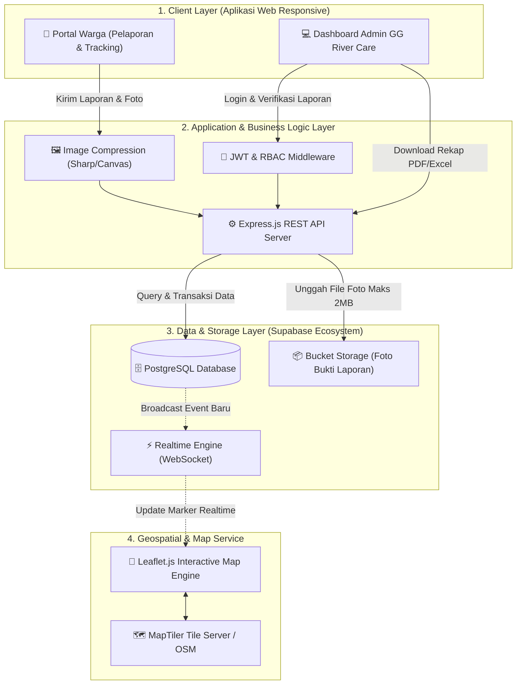

# 🌊 SIPEPES (Sistem Informasi Pelaporan Pencemaran Sungai)

[](https://nodejs.org/)
[](https://react.dev/)
[](https://www.typescriptlang.org/)
[](https://supabase.com/)
[](https://leafletjs.com/)
[](LICENSE)

> **Platform Web Kolaboratif untuk Pelaporan, Pemantauan Sebaran Titik Tercemar Secara Real-Time, dan Rekapitulasi Advokasi Lingkungan di Kawasan Sungai Musi Palembang.**  
> Mitra Komunitas: **Green Generation Palembang (Program GG River Care)**  
> Mata Kuliah: **Proyek Sistem Informasi (Fasilkom Unsri)** — Dosen Pengampu: **Habi Baturohmah, S.Kom., M.Kom.**

---

## 📌 1. Gambaran Umum Arsitektur Sistem

SIPEPES dirancang dengan arsitektur *Client-Server* modern yang mengutamakan kecepatan respons, kehandalan penanganan berkas foto, serta visualisasi geospasial real-time yang ringan.



---

## 📂 2. Struktur Repositori

Repositori ini mengadopsi struktur terpisah yang terstandarisasi untuk kolaborasi 13 orang anggota tim:

```text
SIPEPES/
├── client/                     # Antarmuka Pengguna (Vite + React + Tailwind CSS)
│   ├── src/
│   │   ├── assets/             # Logo, icon, dan aset statis
│   │   ├── components/         # Komponen UI modular (Navbar, Card, Modal, Map)
│   │   ├── hooks/              # Custom hooks (useReports, useAuth, useGeo)
│   │   ├── pages/              # Halaman Warga (Form, Peta, Detail) & Admin (Dashboard)
│   │   ├── services/           # HTTP API client (Axios/Fetch instance)
│   │   └── utils/              # Helper format tanggal, kompresi gambar, validator
│   └── package.json
│
├── server/                     # Backend API (Node.js + Express.js + PostgreSQL)
│   ├── src/
│   │   ├── config/             # Konfigurasi Supabase, Database pool, JWT
│   │   ├── controllers/        # Handler request HTTP (ReportController, AuthController)
│   │   ├── middleware/         # Validasi request, Auth guard, Error handler
│   │   ├── models/             # Schema & query data PostgreSQL
│   │   ├── routes/             # Routing REST API (/api/v1/...)
│   │   ├── services/           # Business logic (Verifikasi, Kompresi, Ekspor)
│   │   └── utils/              # Logger, response formatter, file helper
│   └── package.json
│
├── docs/                       # Dokumentasi Teknis Lengkap (Tech Lead & Analyst)
│   ├── PRD_SRS.md              # Software Requirements Specification (FR & NFR)
│   ├── DESIGN_SYSTEM.md        # Panduan Warna, Tipografi, & Komponen UI/UX
│   ├── ERD_SCHEMA.md           # Desain Skema Basis Data & DDL PostgreSQL
│   ├── API_CONTRACT.md         # Kontrak Endpoint REST API & Contoh Payload
│   └── GIT_WORKFLOW.md         # Aturan Branching, Commit, & Pull Request
│
├── .env.example                # Template variabel lingkungan
├── .gitignore                  # Berkas pengecualian Git
└── README.md                   # Dokumentasi Utama Proyek
```

---

## 📖 3. Indeks Dokumentasi Teknis

Sebagai acuan resmi tim pengembang, seluruh spesifikasi detail telah didokumentasikan di folder `docs/`:

| Dokumen | Deskripsi | Target Pembaca |
| :--- | :--- | :--- |
| [📘 **`PRD & SRS Spesifikasi`**](docs/PRD_SRS.md) | Kebutuhan Fungsional (FR-1 s.d. FR-8), Non-Fungsional, dan Aktor Sistem. | System Analyst, QA, Dosen |
| [🎨 **`Design System & Warna`**](docs/DESIGN_SYSTEM.md) | Palet warna Sungai Musi, tipografi, grid system, dan komponen interaktif. | UI/UX Designer & Frontend Dev |
| [🗄️ **`ERD & Skema Basis Data`**](docs/ERD_SCHEMA.md) | Relasi entitas (ERD Mermaid), tipe data, DDL SQL, dan optimasi kueri. | Backend Dev & Data Analyst |
| [🔌 **`API Contract & Endpoints`**](docs/API_CONTRACT.md) | Spesifikasi RESTful API, format response standar, dan status HTTP. | Frontend Dev & Backend Dev |
| [🚀 **`Git Workflow & Panduan Tim`**](docs/GIT_WORKFLOW.md) | Standar branching, format commit message, dan aturan code review. | Seluruh 13 Anggota Tim |

---

## ⚡ 4. Panduan Menjalankan Proyek (Quick Start)

### Prasyarat:
* Node.js v18.0 atau lebih baru
* npm v9.0 atau pnpm/yarn
* Akun Supabase (untuk Database PostgreSQL & Storage foto)

### Langkah Instalasi:

1. **Clone repositori:**
   ```bash
   git clone https://github.com/GhalibAG/SIPEPES.git
   cd SIPEPES
   ```

2. **Setup Variabel Lingkungan:**
   ```bash
   cp .env.example .env
   # Buka .env dan lengkapi SUPABASE_URL, SUPABASE_ANON_KEY, dan DATABASE_URL
   ```

3. **Jalankan Backend Server:**
   ```bash
   cd server
   npm install
   npm run dev
   # Server aktif di http://localhost:5000/api/v1
   ```

4. **Jalankan Frontend Client (Terminal Baru):**
   ```bash
   cd client
   npm install
   npm run dev
   # Client aktif di http://localhost:5173
   ```

---

## 👥 5. Struktur Tim Pengembang (MuSilaban - Tim 3)

* **Project Manager:** M. Ghalib Assiddiq Gusri
* **Tech Lead & Backend Developer:** M. Naufal Rafif Pratama
* **Backend Developer:** Crespo Silaban
* **Frontend Developers:** Muhamad Radyf Al Zikra, Ahmad Muhtarom
* **UI/UX Designers:** John Felix Simalango, Zira Pertiwi
* **System Analysts:** Dinda Misi Islami, Sri Soepadmi
* **Business Analysts:** Najla Zahra Maharani, Nur Kholisna, Zulfah Shabirah
* **Quality Assurance (QA):** Muhammad Luthfi Erfe

---

© 2026 Tim MuSilaban — Proyek Sistem Informasi Fasilkom Universitas Sriwijaya.
