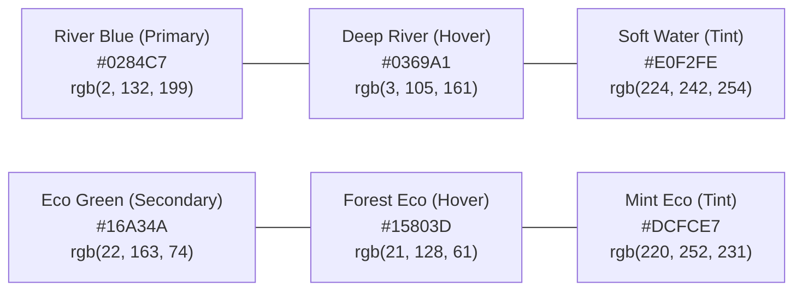
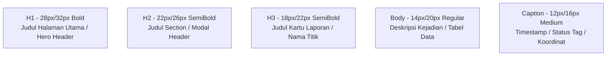

# 🎨 SIPEPES Design System & Visual Guidelines

Dokumen panduan antarmuka pengguna (*UI/UX Design System*) resmi untuk **Sistem Informasi Pelaporan Pencemaran Sungai (SIPEPES)**.  
Acuan kerja bagi **UI/UX Designer (John Felix & Zira)** dan **Frontend Developer (Radyf & Muhtarom)**.

---

## 🌊 1. Filosofi & Konsep Visual

Desain SIPEPES memadukan 3 nilai utama:
1. **Sungai Musi & Air Bersih:** Elemen nuansa biru perairan (*River Blue*) yang melambangkan kejernihan dan harapan ekosistem sungai.
2. **Konservasi & Komunitas Hijau (*Green Generation*):** Aksen hijau alami (*Eco Green*) yang merepresentasikan aksi nyata pemuda peduli lingkungan (*GG River Care*).
3. **Ketegasan Pelaporan & Kejelasan (*Civic Clarity*):** Sistem navigasi bersih (*clean UI*), kontras tinggi, dan ramah pengguna di perangkat seluler (*mobile-first*) bagi warga yang melapor di lapangan.

---

## 🎨 2. Palet Warna Resmi (Color Palette)

### A. Warna Utama (Brand Colors)

| Peran Warna | Nama Token | Nilai Hex | Tailwind Class | Penggunaan Utama |
| :--- | :--- | :---: | :--- | :--- |
| **Primary** | `river-blue-600` | `#0284C7` | `bg-sky-600`, `text-sky-600` | Tombol CTA utama, Header bar, Link aktif |
| **Primary Hover** | `river-blue-700` | `#0369A1` | `bg-sky-700` | Hover state tombol utama, Active tabs |
| **Primary Light** | `river-blue-100` | `#E0F2FE` | `bg-sky-100`, `text-sky-800` | Background badge pelaporan, alert info |
| **Secondary (Eco)** | `eco-green-600` | `#16A34A` | `bg-green-600`, `text-green-600` | Tombol verifikasi admin, status valid |
| **Secondary Hover** | `eco-green-700` | `#15803D` | `bg-green-700` | Hover state aksi positif komunitas |
| **Secondary Light**| `eco-green-100` | `#DCFCE7` | `bg-green-100`, `text-green-800` | Badge status sukses, background verifikasi |

---

### B. Warna Indikator Tingkat Pencemaran (Tingkat Dugaan)
Warna ini **wajib konsisten** pada pin marker peta Leaflet, badge laporan warga, dan tabel admin:

| Tingkat Pencemaran | Nilai Hex | Warna Badge (Tailwind) | Keterangan / Kriteria Lapangan |
| :---: | :---: | :--- | :--- |
| 🔴 **Tercemar Berat** | `#DC2626` | `bg-red-100 text-red-700 border-red-300` | Limbah industri pekat, bau menyengat, bangkai ikan, tumpahan oli/minyak |
| 🟡 **Tercemar Sedang** | `#D97706` | `bg-amber-100 text-amber-700 border-amber-300` | Tumpukan sampah plastik padat, air keruh kecokelatan tidak wajar |
| 🟢 **Tercemar Ringan** | `#059669` | `bg-emerald-100 text-emerald-700 border-emerald-300` | Sampah hanyut musiman, buangan organik domestik skala kecil |

---

### C. Warna Status Alur Laporan (Lifecycle Status)

| Status Laporan | Warna Token | Kode Hex | Badge Styling |
| :--- | :--- | :---: | :--- |
| ⏳ **Menunggu Verifikasi** | Warning Amber | `#D97706` | `bg-yellow-50 text-yellow-800 border-yellow-200` |
| ✅ **Terverifikasi (Valid)** | Info Blue | `#2563EB` | `bg-blue-50 text-blue-800 border-blue-200` |
| ❌ **Ditolak (Tidak Valid)**| Neutral Muted | `#64748B` | `bg-slate-100 text-slate-700 border-slate-300` |

---

### D. Warna Netral & Permukaan (Neutral & Surface)

* **Page Background:** `#F8FAFC` (`bg-slate-50`)
* **Card Surface:** `#FFFFFF` (`bg-white`)
* **Border & Dividers:** `#E2E8F0` (`border-slate-200`)
* **Heading Text (H1-H3):** `#0F172A` (`text-slate-900`)
* **Body / Paragraph Text:** `#334155` (`text-slate-700`)
* **Muted / Subtitle Text:** `#64748B` (`text-slate-500`)

---

## 🔤 3. Tipografi (Typography)

* **Font Utama:** `Inter` atau `Plus Jakarta Sans` (Sans-Serif modern dan mudah dibaca di layar HP).
* **Font Monospace:** `JetBrains Mono` / `Fira Code` (untuk koordinat latitude/longitude).

---

## 🧱 4. Standar Komponen UI

### 1. Tombol Utama (Button Component)
* **Primary (Lapor Sekarang):** `bg-sky-600 text-white rounded-lg px-4 py-2.5 font-medium hover:bg-sky-700 shadow-sm transition`
* **Secondary (Lihat Peta):** `bg-white text-slate-700 border border-slate-300 rounded-lg px-4 py-2.5 hover:bg-slate-50 transition`
* **Success/Verify (Admin Verifikasi):** `bg-green-600 text-white rounded-lg px-3 py-1.5 hover:bg-green-700`
* **Danger/Reject (Admin Tolak):** `bg-red-600 text-white rounded-lg px-3 py-1.5 hover:bg-red-700`

### 2. Desain Marker Peta (Leaflet Map Pins)
Setiap pin di peta interaktif menggunakan ikon SVG kustom berbentuk tetesan air (*water droplet pin*) dengan titik pusat warna:
* Radius pin aktif: **32px × 32px**.
* Popup interaktif memuat: Thumbnail foto (kompresi 80px), Judul kejadian, Badge tingkat pencemaran, Nama kelurahan/kecamatan, dan Tanggal lapor.

### 3. Formulir Pelaporan Ramah Seluler (Mobile-Friendly Form)
1. **Input Foto:** Pratinjau langsung (*Live Preview*), batas 1 foto bukti utama, rasio landscape 4:3.
2. **Pendeteksi Lokasi Otomatis:** Tombol *"Gunakan Titik GPS Saya"* menggunakan HTML5 Geolocation API, disertai pin yang dapat digeser manual di atas peta mini.
3. **Deskripsi:** Textarea dengan *character counter* (maksimal 500 karakter).

---

© 2026 SIPEPES Tech Lead & UI/UX Guidelines — Tim 3 MuSilaban.
