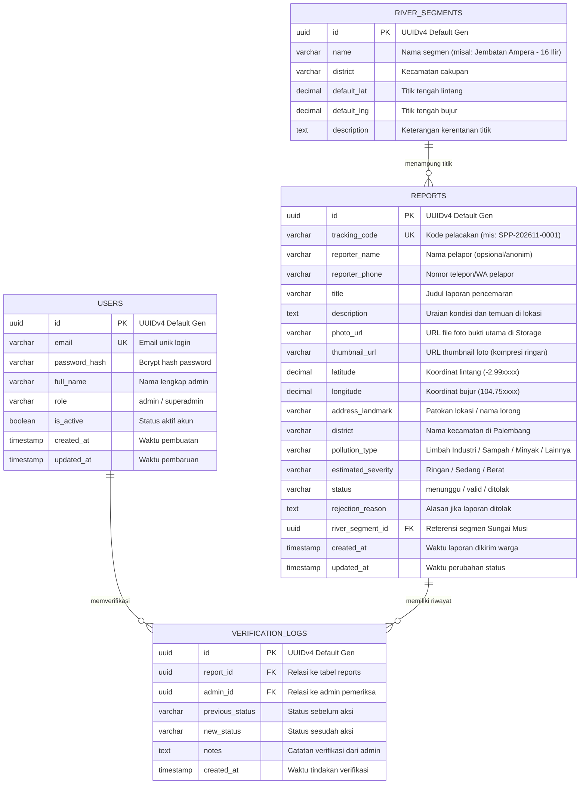

# 🗄️ Desain Skema Basis Data & ERD (Entity Relationship Diagram)
## Sistem Informasi Pelaporan Pencemaran Sungai (SIPEPES)

Dokumen acuan teknis arsitektur basis data relasional PostgreSQL untuk **Backend Developer (Naufal & Crespo)** dan **System Analyst (Dinda & Sri)**.

---

## 📊 1. Diagram Relasi Entitas (ERD - Mermaid)



---

## 📋 2. Kamus Data Rinci (Data Dictionary)

### A. Tabel `reports` (Entitas Utama Pelaporan)

| Nama Kolom | Tipe Data | Nullable | Nilai Bawaan | Keterangan & Aturan Validasi |
| :--- | :--- | :---: | :---: | :--- |
| `id` | `UUID` | **NO** | `gen_random_uuid()` | Primary Key acak aman |
| `tracking_code` | `VARCHAR(30)` | **NO** | - | Unique. Format: `SPP-YYYYMM-XXXX` |
| `reporter_name` | `VARCHAR(100)` | YES | `'Warga Peduli'` | Nama pelapor atau nama komunitas |
| `reporter_phone`| `VARCHAR(20)` | YES | `NULL` | Kontak untuk konfirmasi jika dibutuhkan |
| `title` | `VARCHAR(150)` | **NO** | - | Ringkasan temuan pencemaran |
| `description` | `TEXT` | **NO** | - | Maksimal 1000 karakter |
| `photo_url` | `VARCHAR(500)` | **NO** | - | URL publik foto dari bucket storage |
| `latitude` | `DECIMAL(10, 7)`| **NO** | - | Koordinat lintang (-2.80 s.d. -3.10) |
| `longitude` | `DECIMAL(10, 7)`| **NO** | - | Koordinat bujur (104.60 s.d. 104.90) |
| `address_landmark`| `VARCHAR(255)`| YES | `NULL` | Patokan fisik (dekat jembatan, dermaga, dll) |
| `district` | `VARCHAR(100)` | **NO** | - | Nama Kecamatan (Ilir Timur, Seberang Ulu, dll) |
| `pollution_type` | `VARCHAR(50)` | **NO** | - | ENUM: `limbah_industri`, `sampah_domestik`, `minyak_oli`, `lainnya` |
| `estimated_severity`| `VARCHAR(20)`| **NO** | `'sedang'` | ENUM: `ringan`, `sedang`, `berat` |
| `status` | `VARCHAR(20)` | **NO** | `'menunggu'` | ENUM: `menunggu`, `valid`, `ditolak` |
| `rejection_reason` | `TEXT` | YES | `NULL` | Diisi jika status diubah menjadi `ditolak` |
| `river_segment_id` | `UUID` | YES | `NULL` | FK ke master data segmen sungai |
| `created_at` | `TIMESTAMPTZ` | **NO** | `NOW()` | Waktu kirim pelaporan |
| `updated_at` | `TIMESTAMPTZ` | **NO** | `NOW()` | Waktu modifikasi terakhir |

---

## ⚡ 3. Strategi Indexing & Performa Kueri

Kueri peta dan filter dashboard admin membutuhkan performa tinggi:
1. **Index Titik Peta Publik (`status = 'valid'`):**
   ```sql
   CREATE INDEX idx_reports_map_filter ON reports (status, latitude, longitude) WHERE status = 'valid';
   ```
2. **Index Pencarian Kode Tiket Pelapor:**
   ```sql
   CREATE UNIQUE INDEX idx_reports_tracking_code ON reports (tracking_code);
   ```
3. **Index Riwayat Verifikasi:**
   ```sql
   CREATE INDEX idx_verification_logs_report_id ON verification_logs (report_id, created_at DESC);
   ```

---

## 🛠️ 4. Naskah SQL DDL Siap Eksekusi (PostgreSQL / Supabase)

Salin kode SQL berikut langsung ke **Supabase SQL Editor** untuk membuat skema secara instan:

```sql
-- Aktifkan ekstensi UUID
CREATE EXTENSION IF NOT EXISTS "uuid-ossp";

-- 1. Tabel Users (Admin & Pengurus Komunitas)
CREATE TABLE IF NOT EXISTS users (
    id UUID PRIMARY KEY DEFAULT gen_random_uuid(),
    email VARCHAR(100) UNIQUE NOT NULL,
    password_hash VARCHAR(255) NOT NULL,
    full_name VARCHAR(150) NOT NULL,
    role VARCHAR(20) DEFAULT 'admin' CHECK (role IN ('admin', 'superadmin')),
    is_active BOOLEAN DEFAULT TRUE,
    created_at TIMESTAMPTZ DEFAULT NOW(),
    updated_at TIMESTAMPTZ DEFAULT NOW()
);

-- 2. Tabel Master Segmen Sungai Musi
CREATE TABLE IF NOT EXISTS river_segments (
    id UUID PRIMARY KEY DEFAULT gen_random_uuid(),
    name VARCHAR(150) NOT NULL,
    district VARCHAR(100) NOT NULL,
    default_lat DECIMAL(10, 7) NOT NULL,
    default_lng DECIMAL(10, 7) NOT NULL,
    description TEXT,
    created_at TIMESTAMPTZ DEFAULT NOW()
);

-- 3. Tabel Laporan Pencemaran Sungai (Reports)
CREATE TABLE IF NOT EXISTS reports (
    id UUID PRIMARY KEY DEFAULT gen_random_uuid(),
    tracking_code VARCHAR(30) UNIQUE NOT NULL,
    reporter_name VARCHAR(100) DEFAULT 'Warga Peduli',
    reporter_phone VARCHAR(20),
    title VARCHAR(150) NOT NULL,
    description TEXT NOT NULL,
    photo_url VARCHAR(500) NOT NULL,
    thumbnail_url VARCHAR(500),
    latitude DECIMAL(10, 7) NOT NULL,
    longitude DECIMAL(10, 7) NOT NULL,
    address_landmark VARCHAR(255),
    district VARCHAR(100) NOT NULL,
    pollution_type VARCHAR(50) NOT NULL CHECK (pollution_type IN ('limbah_industri', 'sampah_domestik', 'minyak_oli', 'lainnya')),
    estimated_severity VARCHAR(20) NOT NULL DEFAULT 'sedang' CHECK (estimated_severity IN ('ringan', 'sedang', 'berat')),
    status VARCHAR(20) NOT NULL DEFAULT 'menunggu' CHECK (status IN ('menunggu', 'valid', 'ditolak')),
    rejection_reason TEXT,
    river_segment_id UUID REFERENCES river_segments(id) ON DELETE SET NULL,
    created_at TIMESTAMPTZ DEFAULT NOW(),
    updated_at TIMESTAMPTZ DEFAULT NOW()
);

-- 4. Tabel Log Riwayat Audit Verifikasi Admin
CREATE TABLE IF NOT EXISTS verification_logs (
    id UUID PRIMARY KEY DEFAULT gen_random_uuid(),
    report_id UUID NOT NULL REFERENCES reports(id) ON DELETE CASCADE,
    admin_id UUID NOT NULL REFERENCES users(id) ON DELETE RESTRICT,
    previous_status VARCHAR(20) NOT NULL,
    new_status VARCHAR(20) NOT NULL,
    notes TEXT,
    created_at TIMESTAMPTZ DEFAULT NOW()
);

-- 5. Trigger Otomatis Pembaruan kolom updated_at
CREATE OR REPLACE FUNCTION update_timestamp_column()
RETURNS TRIGGER AS $$
BEGIN
    NEW.updated_at = NOW();
    RETURN NEW;
END;
$$ LANGUAGE plpgsql;

CREATE TRIGGER update_reports_updated_at
BEFORE UPDATE ON reports
FOR EACH ROW
EXECUTE FUNCTION update_timestamp_column();

-- Data Awal Segmen Sungai Musi (Seed Data)
INSERT INTO river_segments (name, district, default_lat, default_lng, description) VALUES
('Kawasan Benteng Kuto Besak - 16 Ilir', 'Bukit Kecil', -2.9912000, 104.7615000, 'Titik kumpul aktivitas wisata dan dermaga jukung'),
('Kawasan Seberang Ulu - Jembatan Ampera', 'Seberang Ulu I', -2.9935000, 104.7640000, 'Kawasan pemukiman padat bantaran sungai'),
('Kawasan Gandus - Aliran Hulu', 'Gandus', -3.0125000, 104.7150000, 'Titik aliran perbatasan industri dan alam'),
('Kawasan Tangga Buntung - 36 Ilir', 'Ilir Barat II', -2.9950000, 104.7380000, 'Daerah aliran tepian pemukiman warga')
ON CONFLICT DO NOTHING;
```

---

© 2026 SIPEPES Database Architecture — Tim 3 MuSilaban.
