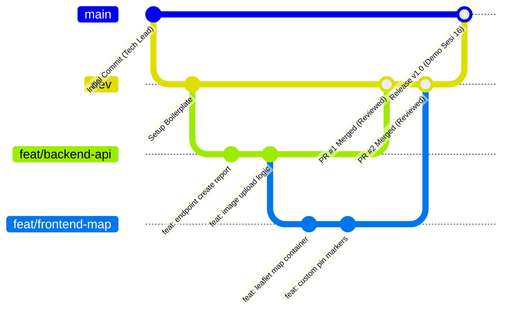

# 🌿 Panduan Kolaborasi Git & Branching Strategy
## Tim MuSilaban (13 Anggota) — Proyek SIPEPES

Agar 13 orang anggota tim pengembang dapat bekerja secara serentak tanpa saling menimpa (*merge conflict*) atau merusak kode yang sudah stabil, ikuti aturan Git resmi berikut:

---

## 🌳 1. Model Percabangan (Branching Model)



### Aturan Cabang (Branch Hierarchy):
1. **`main` (Production Branch):**
   * Hanya berisi kode yang sudah 100% teruji dan siap demonstrasi perkuliahan.
   * Dilarang melakukan *direct push* ke `main`.
2. **`dev` (Development Integration Branch):**
   * Cabang utama untuk menggabungkan seluruh fitur harian tim.
   * Pengujian integrasi (Frontend + Backend) dilakukan di cabang ini.
3. **`feat/<nama-fitur>` (Feature Branches):**
   * Dibuat dari `dev` untuk setiap aktivitas spesifik pada jadwal.
   * Contoh penamaan:
     * `feat/frontend-form-lapor` (Radyf)
     * `feat/frontend-dashboard-admin` (Muhtarom)
     * `feat/backend-report-api` (Naufal)
     * `feat/backend-export-pdf` (Crespo)
     * `docs/srs-update` (Dinda / Sri)

---

## 📝 2. Format Pesan Komit (Conventional Commits)

Format standar: `<tipe>: <keterangan singkat dalam bahasa indonesia/inggris>`

| Tipe Komit | Kapan Digunakan | Contoh Pesan Komit |
| :--- | :--- | :--- |
| **`feat`** | Menambahkan fitur atau fungsionalitas baru | `feat: tambahkan validasi koordinat gps pada form pelaporan` |
| **`fix`** | Memperbaiki bug atau galat teknis | `fix: atasi memory leak pada kompresi gambar sharp` |
| **`docs`** | Pembaruan dokumen markdown / komentar | `docs: perbarui spesifikasi api endpoint verification` |
| **`style`** | Mengubah styling CSS / Tailwind tanpa ubah logika | `style: sesuaikan warna pin marker tercemar berat ke red-600` |
| **`refactor`**| Merapikan kode tanpa menambah fitur baru | `refactor: pisahkan logika database pool ke config/db.js` |
| **`chore`** | Pembaruan konfigurasi package.json / build tool | `chore: pasang dependency leaflet dan lucide-react` |

---

## 🚀 3. Panduan Langkah Harian Anggota Tim

### 1. Sebelum Mulai Koding (Tarik Kode Terbaru):
```bash
git checkout dev
git pull origin dev
```

### 2. Buat Branch Fitur Baru:
```bash
git checkout -b feat/nama-fitur-kamu
```

### 3. Simpan & Komit Pekerjaan:
```bash
git status
git add .
git commit -m "feat: deskripsi pekerjaan yang telah selesai"
```

### 4. Kirim ke GitHub & Ajukan Pull Request (PR):
```bash
git push -u origin feat/nama-fitur-kamu
```
Buka halaman repositori di GitHub, lalu klik **"Compare & Pull Request"** menuju target branch **`dev`**, dan tag **@Naufal (Tech Lead)** atau **@Ghalib (PM)** untuk direview.

---

© 2026 SIPEPES Engineering Workflow — Tim 3 MuSilaban.
