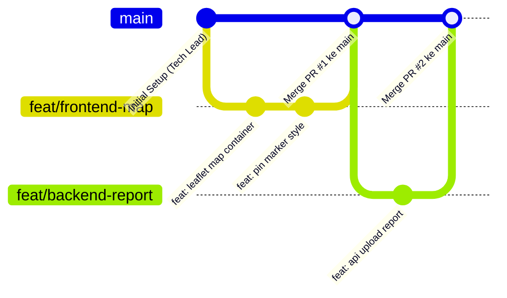

# 🌿 Panduan Kolaborasi Git (GitHub Flow Sederhana)
## Tim MuSilaban (13 Anggota) — Proyek SIPEPES

Untuk menjaga alur kerja tetap praktis, mudah dipahami oleh seluruh anggota tim, dan langsung tampil di halaman depan GitHub, repositori SIPEPES menggunakan **branch `main` sebagai cabang utama**.

---

## 🌳 1. Model Percabangan Sederhana (GitHub Flow)



### Aturan Cabang:
1. **`main` (Cabang Utama):**
   * Berisi seluruh kode proyek yang aktif dan langsung terlihat oleh dosen dan tim di halaman utama GitHub.
   * Setiap anggota tim selalu menarik (*pull*) kode terbaru dari `main`.
2. **`feat/<nama-fitur>` atau `fix/<nama-bug>` (Cabang Fitur/Perbaikan):**
   * Dibuat langsung dari `main` saat mengerjakan tugas spesifik.
   * Contoh: `feat/form-laporan`, `feat/peta-leaflet`, `feat/api-verifikasi`.
   * Setelah selesai, gabungkan (*merge*) kembali ke `main`.

---

## 📝 2. Format Pesan Komit (Conventional Commits)

Format standar: `<tipe>: <keterangan singkat dalam bahasa indonesia>`

| Tipe Komit | Kapan Digunakan | Contoh Pesan Komit |
| :--- | :--- | :--- |
| **`feat`** | Menambahkan fitur atau komponen baru | `feat: tambahkan validasi koordinat gps pada form pelaporan` |
| **`fix`** | Memperbaiki bug atau galat teknis | `fix: perbaiki posisi pin marker peta leaflet` |
| **`docs`** | Pembaruan dokumen markdown / instruksi | `docs: lengkapi skema database di erd schema` |
| **`style`** | Mengubah styling CSS / Tailwind tanpa ubah logika | `style: sesuaikan warna tombol ke brand river blue` |
| **`refactor`**| Merapikan kode tanpa menambah fitur baru | `refactor: pisahkan konfigurasi supabase client` |

---

## 🚀 3. Panduan Langkah Praktis Anggota Tim

### 1. Sebelum Mulai Koding (Tarik Kode Terbaru):
```bash
git checkout main
git pull origin main
```

### 2. Buat Cabang Fitur Baru:
```bash
git checkout -b feat/nama-fitur-kamu
```

### 3. Simpan Pekerjaan:
```bash
git status
git add .
git commit -m "feat: jelaskan apa yang baru selesai dibuat"
```

### 4. Kirim ke GitHub & Gabungkan ke `main`:
```bash
git push -u origin feat/nama-fitur-kamu
```
Buka halaman repositori di GitHub, lalu klik **"Compare & Pull Request"** menuju branch **`main`**. Setelah dicek tidak ada bentrok, klik **"Merge Pull Request"**.

---

© 2026 SIPEPES Engineering Workflow — Tim 3 MuSilaban.
