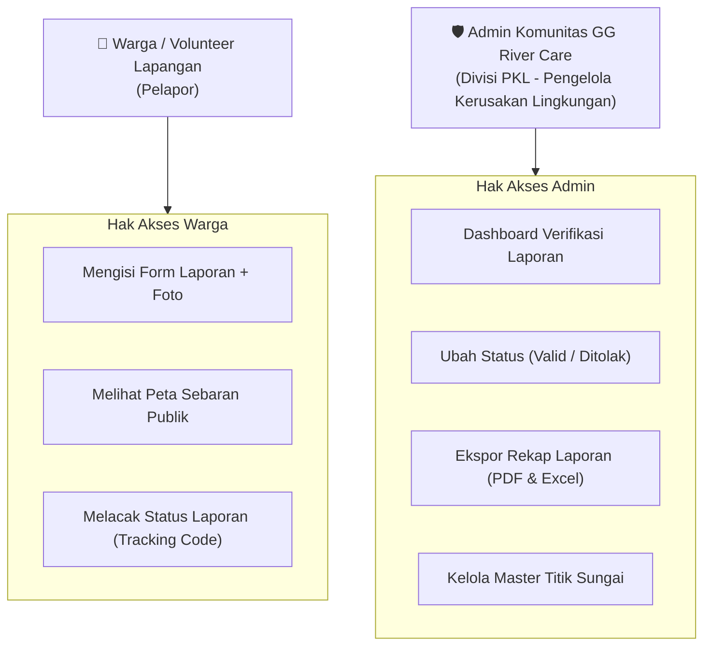
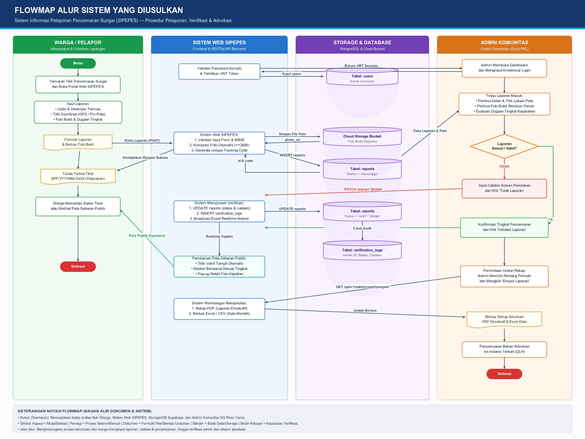
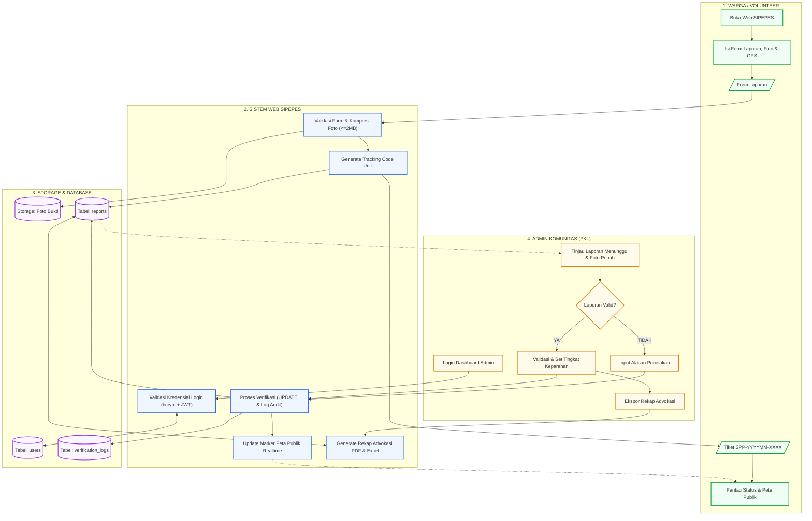
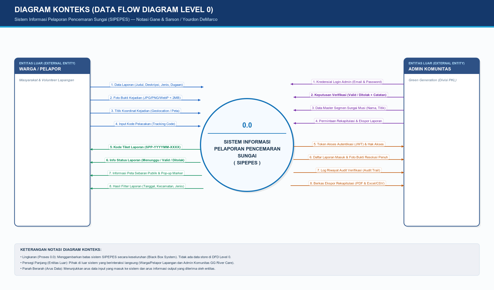
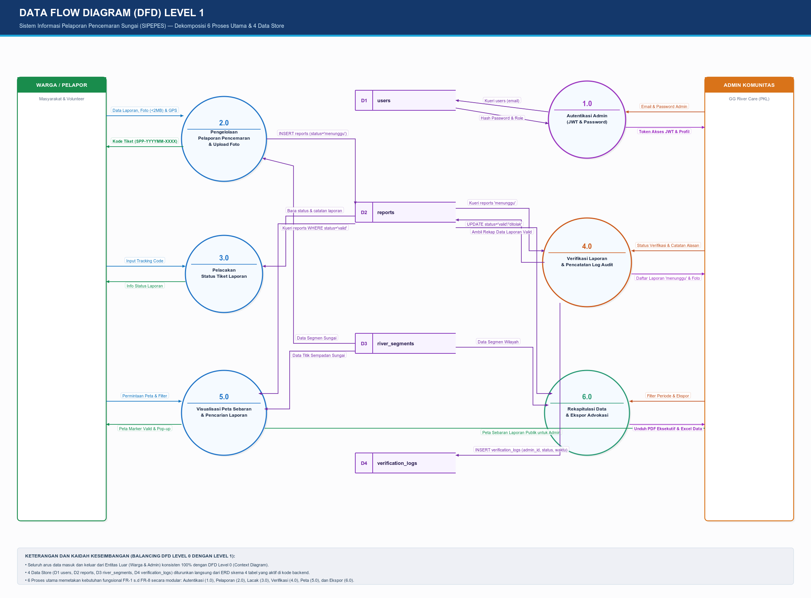
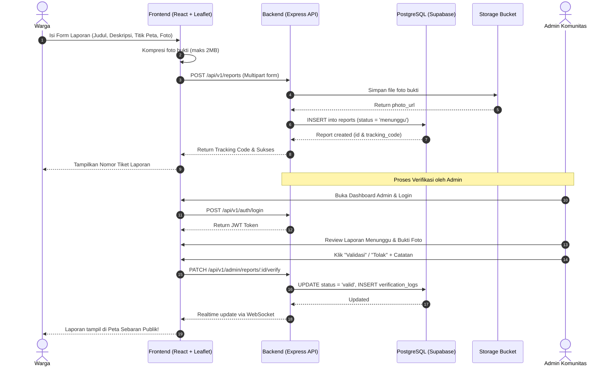

# 📘 Product Requirements Document (PRD) & Software Requirements Specification (SRS)
## Sistem Informasi Pelaporan Pencemaran Sungai (SIPEPES)

---

| Parameter Dokumen | Rincian |
| :--- | :--- |
| **Nama Proyek** | Sistem Informasi Pelaporan Pencemaran Sungai (SIPEPES) |
| **Mitra Komunitas** | Green Generation Palembang (Program *GG River Care*) |
| **Target Wilayah** | Kawasan Percontohan Sungai Musi, Kota Palembang |
| **Dosen Pengampu** | Habi Baturohmah, S.Kom., M.Kom. (Proyek Sistem Informasi) |
| **Tech Lead** | M. Naufal Rafif Pratama |
| **Versi Dokumen** | 1.0 (Baseline Engineering) |

---

## 🎯 1. Ringkasan Eksekutif & Latar Belakang

Pencemaran di sepanjang aliran Sungai Musi (limbah industri, sampah domestik, dan limbah minyak) kerap kali ditemukan pertama kali oleh warga atau sukarelawan komunitas peduli lingkungan. Namun, selama ini pelaporan masih tersebar melalui media sosial atau pesan WhatsApp sehingga:
1. Lokasi koordinat tidak akurat (*tanpa geo-tagging*).
2. Data bukti tidak terpusat dan rawan hilang.
3. Komunitas kesulitan merekap data historis sebagai bahan advokasi resmi kepada instansi pemerintah berwenang.

**SIPEPES** hadir sebagai solusi berbasis web terintegrasi yang memungkinkan warga mengirimkan laporan pencemaran berfoto dan berkoordinat secara mudah, serta memfasilitasi admin komunitas *GG River Care* untuk memvalidasi, memantau peta sebaran *real-time*, dan mengunduh rekapitulasi data terstruktur.

---

## 👥 2. Aktor & User Personas

1. **Warga / Volunteer Komunitas:**
   * Masyarakat umum di sekitar bantaran Sungai Musi atau sukarelawan GG River Care.
   * Kebutuhan: Mengirim laporan secepat mungkin dari ponsel saat melihat titik pencemaran, tanpa proses registrasi akun yang rumit.
2. **Admin Komunitas (Divisi PKL):**
   * Pengurus Green Generation Palembang yang bertugas menyaring laporan.
   * Kebutuhan: Melihat foto bukti, memeriksa lokasi di peta, mengubah status laporan, dan mengekspor data ke Excel/PDF untuk audiensi dengan Dinas Lingkungan Hidup.

---

## 🔄 3. Pemodelan Alur Sistem Terstruktur (Flowmap & DFD)

Sesuai metodologi analisis dan perancangan terstruktur, alur sistem dimodelkan secara bertahap mulai dari aliran prosedur fisik (*Flowmap*), batasan sistem makro (*Diagram Konteks / DFD Level 0*), hingga dekomposisi fungsional (*DFD Level 1*):

### 3.1 Flowmap Alur Sistem yang Diusulkan
Flowmap memetakan interaksi lintas entitas (*swimlane*) antara Warga Pelapor, Sistem Web SIPEPES, Storage & Database Supabase, serta Admin Komunitas GG River Care:

*Berkas mentah yang dapat diedit langsung: [`docs/Flowmap_SIPEPES.drawio`](Flowmap_SIPEPES.drawio).*

### 3.2 Diagram Konteks (DFD Level 0)
Diagram Konteks menggambarkan sistem SIPEPES sebagai proses tunggal (`0.0`) dengan 2 entitas luar utama:

*Berkas mentah yang dapat diedit langsung: [`docs/DFD_Level_0_SIPEPES.drawio`](DFD_Level_0_SIPEPES.drawio).*

### 3.3 Data Flow Diagram (DFD) Level 1
DFD Level 1 memecah sistem menjadi 6 proses utama yang terhubung langsung dengan 4 Data Store basis data relasional:

*Berkas mentah yang dapat diedit langsung: [`docs/DFD_Level_1_SIPEPES.drawio`](DFD_Level_1_SIPEPES.drawio).*

---

## ⚙️ 4. Spesifikasi Kebutuhan Fungsional (Functional Requirements)

| Kode FR | Nama Fitur | Deskripsi Fungsional | Aktor |
| :--- | :--- | :--- | :---: |
| **FR-1** | **Autentikasi Admin** | Login aman berbasis JWT (JSON Web Token) dengan proteksi *password hashing* (bcrypt) untuk admin komunitas. | Admin |
| **FR-2** | **Pelaporan Geo-tagged** | Warga dapat menginput judul, deskripsi pencemaran, jenis limbah, tingkat dugaan (Ringan, Sedang, Berat), dan koordinat GPS (via HTML5 Geolocation atau pin peta interaktif). | Warga |
| **FR-3** | **Unggah Bukti Foto Terkompresi** | Sistem memvalidasi berkas foto (JPG/PNG/WebP), melakukan kompresi otomatis di sisi *client* sebelum diunggah (ukuran maksimal 2MB), dan menyimpannya di Cloud Storage. | Warga |
| **FR-4** | **Pelacakan Tiket Laporan** | Sistem menghasilkan kode unik (*Tracking Code*, misal: `SPP-202611-0012`) agar pelapor dapat memeriksa status tindak lanjut laporannya secara transparan. | Warga |
| **FR-5** | **Verifikasi Laporan Admin** | Admin dapat meninjau detail laporan, melihat foto bukti resolusi penuh, dan mengubah status menjadi: **Valid** (ditampilkan ke peta publik) atau **Ditolak** (disertai alasan penolakan). | Admin |
| **FR-6** | **Peta Sebaran Interaktif** | Menampilkan peta Kota Palembang (Sungai Musi) dengan pin marker warna sesuai tingkat pencemaran. Marker dapat diklik untuk memunculkan popup ringkasan foto dan tanggal kejadian. | Semua |
| **FR-7** | **Filter & Pencarian Laporan** | Pengguna dapat menyaring titik laporan di peta dan tabel berdasarkan rentang tanggal, tingkat pencemaran, atau kecamatan. | Semua |
| **FR-8** | **Ekspor Rekapitulasi Advokasi** | Admin dapat mengekspor rekapitulasi data laporan yang berstatus valid ke format **PDF (Laporan Eksekutif)** dan **Excel / CSV (Data Mentah)** untuk bahan advokasi komunitas. | Admin |

---

## 🛡️ 5. Spesifikasi Kebutuhan Non-Fungsional (Non-Functional Requirements)

1. **NFR-1 Performa (*Performance*):**
   * *Response time* API saat memuat titik koordinat laporan di peta tidak boleh melebihi **2 detik**.
   * Pemuatan tiles peta interaktif (Leaflet + MapTiler) maksimal **3 detik** pada koneksi 4G seluler.
2. **NFR-2 Ketersediaan (*Availability*):**
   * Sistem memiliki target *uptime* minimal **99.5%** selama masa uji coba dan demonstrasi proyek.
3. **NFR-3 Keamanan (*Security*):**
   * Seluruh jalur transmisi data menggunakan protokol terenkripsi **HTTPS**.
   * Proteksi terhadap serangan umum web: *SQL Injection* (via parameterization query / ORM), *XSS* (sanitasi teks deskripsi), dan pembatasan MIME type berkas unggahan.
   * Kata sandi admin disimpan dengan *one-way cryptographic hash* (Bcrypt dengan *salt rounds* 10).
4. **NFR-4 Responsivitas Antarmuka (*Usability & Mobile-First*):**
   * Seluruh tampilan form pelaporan dan peta dapat diakses secara proporsional di layar smartphone dengan lebar minimal **360px**.
5. **NFR-5 Integritas & Audit Trail (*Reliability*):**
   * Setiap perubahan status laporan wajib tercatat pada tabel riwayat verifikasi (*audit log*) mencakup identitas admin pengubah dan cap waktu (*timestamp*).

---

## 🚫 6. Batasan & Pengecualian Ruang Lingkup (Out of Scope)
Sesuai kesepakatan Dokumen *Scope Statement*:
* ❌ Tidak mencakup penindakan hukum atau pemberian sanksi/denda kepada pelaku pencemaran (tindak lanjut fisik berada di ranah aparat pemerintah).
* ❌ Tanpa integrasi API sistem kementerian/dinas lingkungan hidup (sistem beroperasi secara mandiri / *standalone*).
* ❌ Tidak menggunakan sensor IoT kualitas air atau hasil uji laboratorium kimiawi (tingkat pencemaran merupakan dugaan visual pelapor dan verifikasi admin).
* ❌ Tanpa aplikasi *native* Android/iOS (fokus pada *Responsive Web Application*).

---

## 📎 7. Lampiran Teknis Pengembang (Developer Technical Appendix)

<b>Klik untuk melihat Sequence Diagram Interaksi Frontend-Backend (Arsip Arsitektur Sistem)</b>

---

© 2026 SIPEPES Engineering Specifications — Tim 3 MuSilaban.
